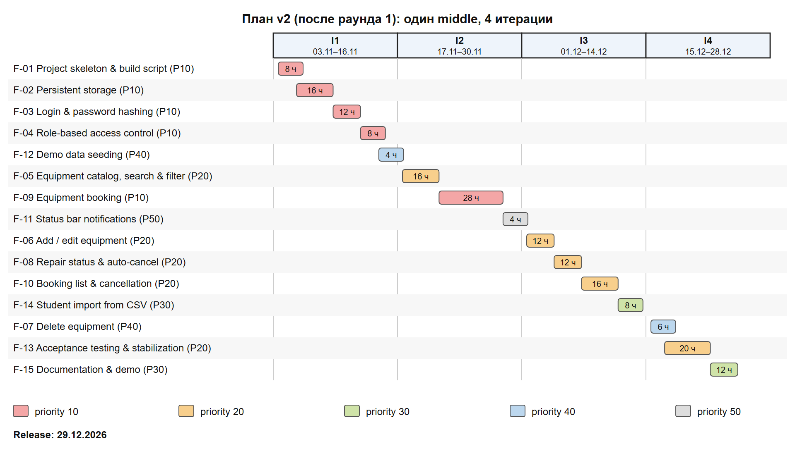
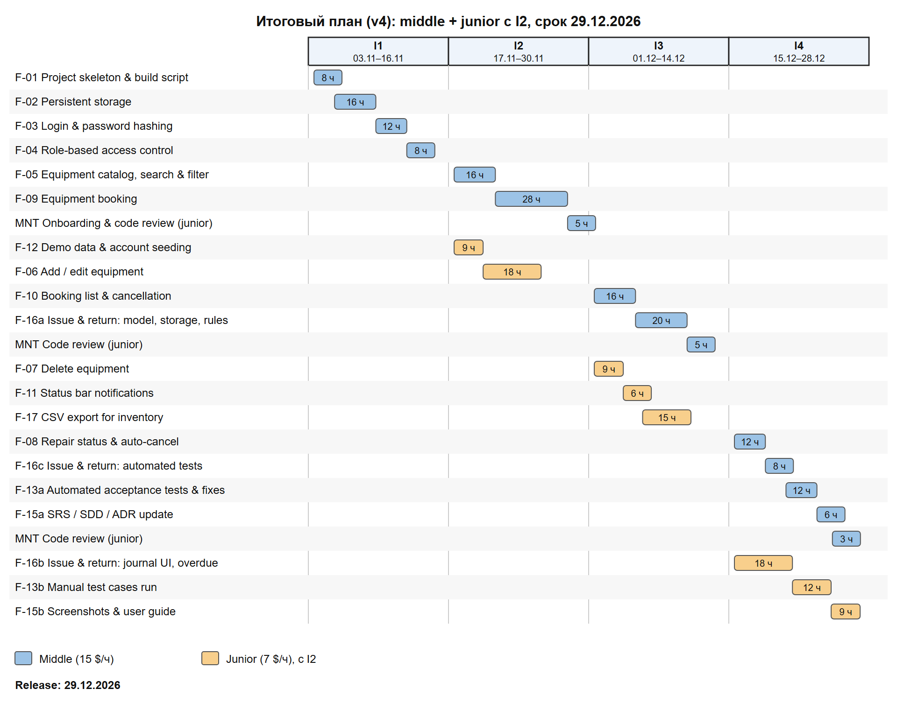

# План реализации

Проект **«Учет лабораторного оборудования»**

Версия 1.0 (согласована 27.10.2026)

Подготовил: Деркачёв М. Ю., группа 450501

## История изменений

| Версия | Дата | Изменение |
|---|---|---|
| v1 | 22.10.2026 | Первичная оценка 15 функций |
| v2 | 24.10.2026 | Раунд 1: упрощены F-03, F-09, F-13, F-14; изменены приоритеты F-07, F-11; план по итерациям |
| v3 | 26.10.2026 | Раунд 2: исключена F-14, добавлены F-16 и F-17; предложен сдвиг релиза (отклонён заказчиком) |
| v4 | 27.10.2026 | Добавлен junior-разработчик с I2; релиз 29.12.2026; итоговый план согласован |

## 1. Условия планирования

- Длина итерации — 2 недели; демонстрация заказчику в конце каждой итерации.
- Ёмкость middle-разработчика — 50 продуктивных часов за итерацию; ставка 15 $/ч.
- Junior-разработчик (с I2) — 30 ч в I2 (вхождение в проект), далее 40 ч за итерацию; ставка 7 $/ч; оценки junior = оценка middle × 1,5.
- Приоритет: 10 — наивысший, 50 — минимальный.
- Срок релиза — 29.12.2026 (не переносится по решению заказчика).

## 2. Первичная оценка (v1)

| ID | Feature | Требования SRS | Priority | Оценка, ч | Стоимость |
|---|---|---|---|---|---|
| F-01 | Project skeleton & build script | REQ-INST-001 | 10 | 8 | 120 $ |
| F-02 | Persistent storage | REQ-REL-001 | 10 | 16 | 240 $ |
| F-03 | Login & password hashing | REQ-FUNC-001, REQ-SEC-001 | 10 | 16 | 240 $ |
| F-04 | Role-based access control | REQ-SEC-001 | 10 | 8 | 120 $ |
| F-05 | Equipment catalog, search & filter | REQ-FUNC-002 | 20 | 16 | 240 $ |
| F-06 | Add / edit equipment | REQ-FUNC-003 | 20 | 12 | 180 $ |
| F-07 | Delete equipment | REQ-FUNC-004 | 30 | 6 | 90 $ |
| F-08 | Repair status & auto-cancel | REQ-FUNC-005 | 20 | 12 | 180 $ |
| F-09 | Equipment booking | REQ-FUNC-006 | 10 | 32 | 480 $ |
| F-10 | Booking list & cancellation | REQ-FUNC-007 | 20 | 16 | 240 $ |
| F-11 | Status bar notifications | SRS 3.3.5 | 40 | 4 | 60 $ |
| F-12 | Demo data seeding | REQ-INST-001 | 40 | 4 | 60 $ |
| F-13 | Acceptance testing & stabilization | SRS 4 | 20 | 24 | 360 $ |
| F-14 | Student account management UI | SRS 2.4 | 30 | 20 | 300 $ |
| F-15 | Documentation & demo | — | 30 | 12 | 180 $ |
|  | Итого |  |  | 206 | 3 090 $ |

## 3. После раунда 1 (v2)

| ID | Feature | Требования SRS | Priority | Оценка, ч | Стоимость |
|---|---|---|---|---|---|
| F-01 | Project skeleton & build script | REQ-INST-001 | 10 | 8 | 120 $ |
| F-02 | Persistent storage | REQ-REL-001 | 10 | 16 | 240 $ |
| F-03 | Login & password hashing | REQ-FUNC-001, REQ-SEC-001 | 10 | 12 | 180 $ |
| F-04 | Role-based access control | REQ-SEC-001 | 10 | 8 | 120 $ |
| F-05 | Equipment catalog, search & filter | REQ-FUNC-002 | 20 | 16 | 240 $ |
| F-06 | Add / edit equipment | REQ-FUNC-003 | 20 | 12 | 180 $ |
| F-07 | Delete equipment | REQ-FUNC-004 | 40 | 6 | 90 $ |
| F-08 | Repair status & auto-cancel | REQ-FUNC-005 | 20 | 12 | 180 $ |
| F-09 | Equipment booking | REQ-FUNC-006 | 10 | 28 | 420 $ |
| F-10 | Booking list & cancellation | REQ-FUNC-007 | 20 | 16 | 240 $ |
| F-11 | Status bar notifications | SRS 3.3.5 | 50 | 4 | 60 $ |
| F-12 | Demo data seeding | REQ-INST-001 | 40 | 4 | 60 $ |
| F-13 | Acceptance testing & stabilization | SRS 4 | 20 | 20 | 300 $ |
| F-14 | Student import from CSV | SRS 2.4 | 30 | 8 | 120 $ |
| F-15 | Documentation & demo | — | 30 | 12 | 180 $ |
|  | Итого |  |  | 182 | 2 730 $ |

| Итерация | Даты | Функции | Загрузка, ч | Запас, ч |
|---|---|---|---|---|
| I1 | 03.11.2026 – 16.11.2026 | F-01, F-02, F-03, F-04, F-12 | 48 | 2 |
| I2 | 17.11.2026 – 30.11.2026 | F-05, F-09, F-11 | 48 | 2 |
| I3 | 01.12.2026 – 14.12.2026 | F-06, F-08, F-10, F-14 | 48 | 2 |
| I4 | 15.12.2026 – 28.12.2026 | F-07, F-13, F-15 | 38 | 12 |

## 4. Раунд 2: изменение объёма

| Задача | Ч |
|---|---|
| F-16 Issue & return log (priority 10): модель брони с состояниями и миграция файла | 8 |
| F-16: правила выдачи и возврата, связь с отменой и ремонтом | 10 |
| F-16: кнопки «Выдать» / «Принять», вкладка «Журнал», подсветка просроченных | 12 |
| F-16: автоматические тесты | 8 |
| F-16: обновление SRS / SDD | 2 |
| F-17 CSV export for inventory (priority 30): каталог и журнал, формат для Excel, тесты | 10 |
| F-14 Student import from CSV — исключена | −8 |
| F-12 Demo data & account seeding — занести список деканата | +2 |
| Изменение объёма | +44 |

### 4.1 Вариант без junior — сдвиг релиза (v3, отклонён)

| Итерация | Даты | Функции | Загрузка, ч | Запас, ч |
|---|---|---|---|---|
| I1 | 03.11.2026 – 16.11.2026 | F-01, F-02, F-03, F-04, F-12 | 50 | 0 |
| I2 | 17.11.2026 – 30.11.2026 | F-05, F-09, F-11 | 48 | 2 |
| I3 | 01.12.2026 – 14.12.2026 | F-06, F-10, F-08 | 40 | 10 |
| I4 | 15.12.2026 – 28.12.2026 | F-16, F-07 | 46 | 4 |
| I5 | 29.12.2026 – 11.01.2027 | F-17, F-13, F-15 | 42 | 8 |

## 5. Итоговый план (v4)

### 5.1 Функции и приоритеты

| ID | Feature | Требования SRS | Priority | Оценка (middle), ч |
|---|---|---|---|---|
| F-01 | Project skeleton & build script | REQ-INST-001 | 10 | 8 |
| F-02 | Persistent storage | REQ-REL-001 | 10 | 16 |
| F-03 | Login & password hashing | REQ-FUNC-001, REQ-SEC-001 | 10 | 12 |
| F-04 | Role-based access control | REQ-SEC-001 | 10 | 8 |
| F-05 | Equipment catalog, search & filter | REQ-FUNC-002 | 20 | 16 |
| F-06 | Add / edit equipment | REQ-FUNC-003 | 20 | 12 |
| F-07 | Delete equipment | REQ-FUNC-004 | 40 | 6 |
| F-08 | Repair status & auto-cancel | REQ-FUNC-005 | 20 | 12 |
| F-09 | Equipment booking | REQ-FUNC-006 | 10 | 28 |
| F-10 | Booking list & cancellation | REQ-FUNC-007 | 20 | 16 |
| F-11 | Status bar notifications | SRS 3.3.5 | 50 | 4 |
| F-12 | Demo data & account seeding | REQ-INST-001 | 40 | 6 |
| F-13 | Acceptance testing & stabilization | SRS 4 | 20 | 20 |
| F-15 | Documentation & demo | — | 30 | 12 |
| F-16 | Issue & return log | REQ-FUNC-008 | 10 | 40 |
| F-17 | CSV export for inventory | REQ-FUNC-009 | 30 | 10 |
|  | Итого |  |  | 226 |

F-16 и F-17 частично выполняет junior (раздел 5.2), поэтому фактическая стоимость считается в разделе 5.4.

### 5.2 Задачи junior-разработчика

| Задача | Оценка middle, ч | Оценка junior (×1,5), ч | Почему подходит junior |
|---|---|---|---|
| F-06 Add / edit equipment | 12 | 18 | типовая форма, правила валидации уже описаны в SRS |
| F-07 Delete equipment | 6 | 9 | диалог подтверждения + вызов готовой проверки |
| F-11 Status bar notifications | 4 | 6 | изолированный компонент UI |
| F-12 Demo data & account seeding | 6 | 9 | заполнение данных по готовому API Store |
| F-17 CSV export for inventory | 10 | 15 | формат зафиксирован в ADR-0008 |
| F-16b Journal UI, overdue | 12 | 18 | UI поверх IssueService, сделанного middle |
| F-13b Manual test cases run | 8 | 12 | прогон чек-листа по SRS |
| F-15b Screenshots & user guide | 6 | 9 | по готовому приложению |
| Итого | 64 | 96 |  |

### 5.3 План по итерациям

| Итерация | Middle: задачи (ч) | Junior: задачи (ч) | M, ч | J, ч |
|---|---|---|---|---|
| I1 03.11–16.11 | F-01 (8), F-02 (16), F-03 (12), F-04 (8) | — (junior ещё не в проекте) | 44 / 50 | — |
| I2 17.11–30.11 | F-05 (16), F-09 (28), Ревью/наставничество (5) | F-12 (9), F-06 (18) | 49 / 50 | 27 / 30 |
| I3 01.12–14.12 | F-10 (16), F-16a (20), Ревью/наставничество (5) | F-07 (9), F-11 (6), F-17 (15) | 41 / 50 | 30 / 40 |
| I4 15.12–28.12 | F-08 (12), F-16c (8), F-13a (12), F-15a (6), Ревью/наставничество (3) | F-16b (18), F-13b (12), F-15b (9) | 41 / 50 | 39 / 40 |

### 5.4 Стоимость вариантов

| Вариант плана | Состав | Часы | Стоимость | Релиз |
|---|---|---|---|---|
| v1 — первичная оценка | middle | 206 | 3 090 $ | не укладывается (4,1 итерации) |
| v2 — после раунда 1 | middle | 182 | 2 730 $ | 29.12.2026 |
| v3 — раунд 2, сдвиг срока | middle | 226 | 3 390 $ | 12.01.2027 (отклонён) |
| v4 — итоговый, с junior | middle + junior | 175 + 96 | 3 297 $ | 29.12.2026 |

Итоговая стоимость: middle 175 ч × 15 $ + junior 96 ч × 7 $ = **3 297 $**.

### 5.5 Риски

| Риск | Мера |
|---|---|
| Junior не успевает | запас 14 ч у junior и 25 ч у middle; первой переносится F-11 (priority 50) |
| Миграция формата броней портит данные | автоматический тест миграции (F-16c), резервная копия `data/` перед обновлением |
| Заказчик добавит ещё функции | новые функции — только в следующий релиз после 29.12.2026 |

Переписка с заказчиком — [correspondence.md](correspondence.md).
