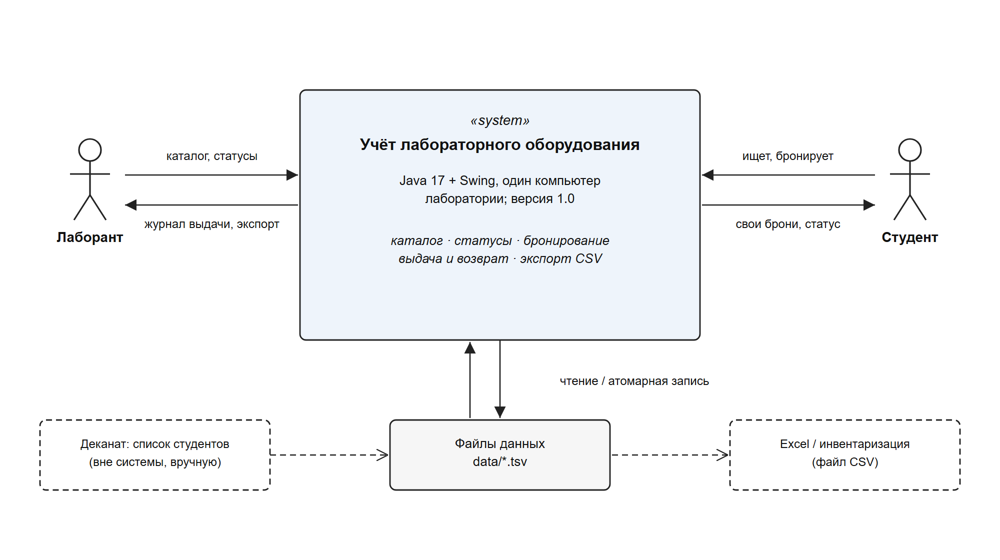
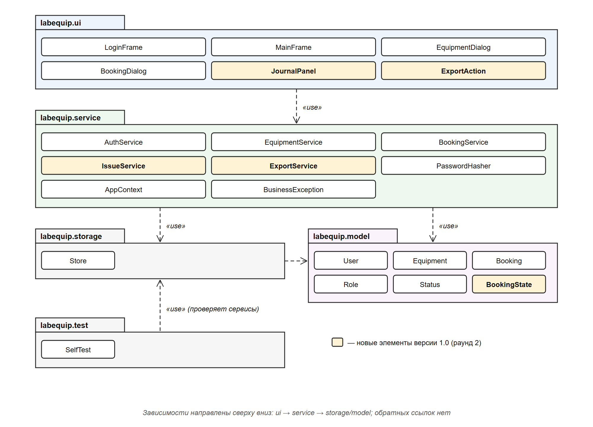
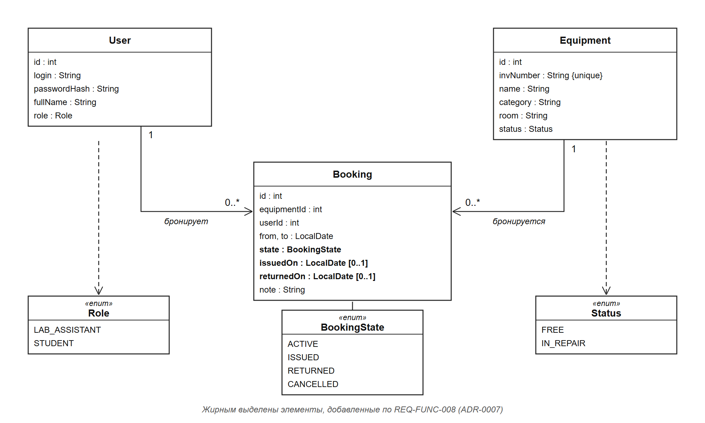
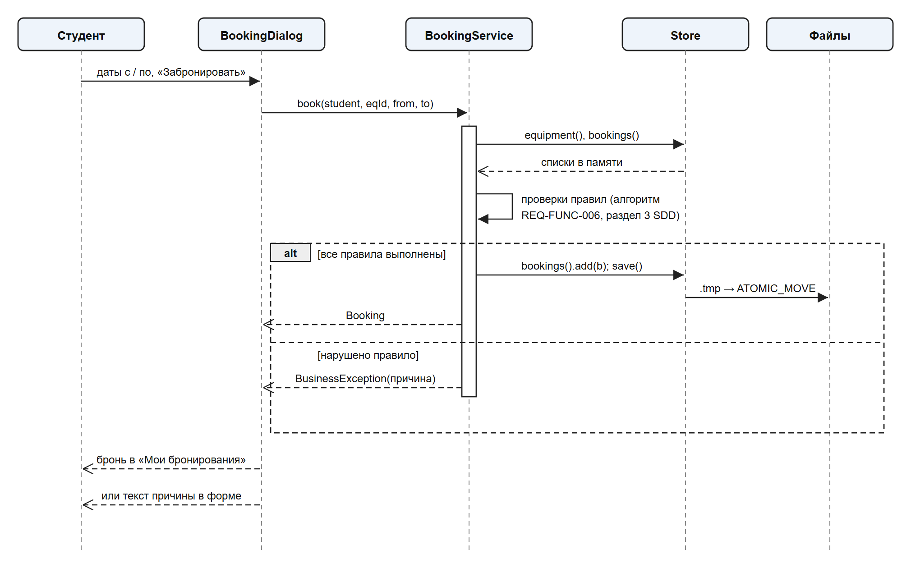
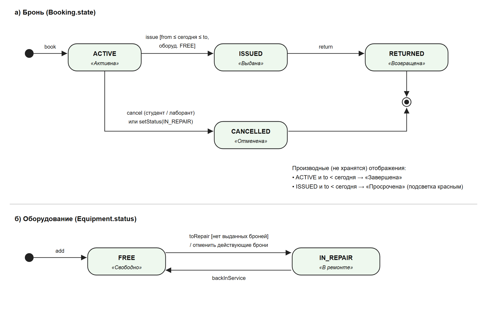

# Описание дизайна программного обеспечения

Для проекта **«Учет лабораторного оборудования»**

Версия 0.2

Подготовил: Деркачёв М. Ю., группа 450501

Организация: учебный проект БГУИР по дисциплине «Жизненный цикл разработки программного обеспечения»

Дата изменения: 27.10.2026

## Оглавление

<!-- TOC -->
* [1. Введение](#1-introduction)
  * [1.1 Назначение документа](#11-document-purpose)
  * [1.2 Область применения](#12-subject-scope)
  * [1.3 Определения, акронимы и сокращения](#13-definitions-acronyms-and-abbreviations)
  * [1.4 Ссылки](#14-references)
  * [1.5 Обзор документа](#15-document-overview)
* [2. Обзор дизайна](#2-design-overview)
  * [2.1 Задачи стейкхолдеров](#21-stakeholder-concerns)
  * [2.2 Выбранные точки зрения](#22-selected-viewpoints)
* [3. Проектные представления](#3-design-views)
* [4. Решения](#4-decisions)
* [5. Приложения](#5-appendixes)
<!-- TOC -->

## История изменений

| Name | Date | Reason For Changes | Version |
|------|------|--------------------|---------|
| Деркачёв М. Ю. | 22.10.2026 | Первоначальный дизайн по SRS 0.2 | 0.1 |
| Деркачёв М. Ю. | 27.10.2026 | Раунд 2 с заказчиком: журнал выдачи и возврата (REQ-FUNC-008), экспорт CSV (REQ-FUNC-009), ADR-0007 и ADR-0008, приоритеты и план итераций | 0.2 |

---

## 1. Введение {#1-introduction}

### 1.1 Назначение документа {#11-document-purpose}

Документ описывает, **как** устроено приложение «Учет лабораторного оборудования»: из каких частей оно состоит, как они взаимодействуют, где хранятся данные и какие архитектурные решения приняты. Документ предназначен для разработчиков проекта (middle- и junior-разработчика), преподавателя как проверяющего и для сопровождения после сдачи. Он опирается на спецификацию требований `docs/srs/labequip_srs.md` (версия 0.3), записи решений `docs/decisions/` и план реализации `docs/plan/labequip_plan.md`.

### 1.2 Область применения {#12-subject-scope}

Проектируемая система — настольное приложение «Учет лабораторного оборудования», версия 1.0 (релиз 29.12.2026). Оно заменяет бумажный журнал лаборатории: лаборант ведёт каталог приборов и их статусы, студенты бронируют свободное оборудование на период, лаборант отмечает фактическую выдачу и возврат и выгружает данные для инвентаризации.

Входит: вход по ролям, каталог и поиск, управление оборудованием и статусами, бронирование, журнал выдачи и возврата, экспорт в CSV.
Не входит: самостоятельная регистрация, уведомления, QR-коды, штрафы, аналитические отчёты, интеграция с деканатом, сетевой многопользовательский режим.

### 1.3 Определения, акронимы и сокращения {#13-definitions-acronyms-and-abbreviations}

| Term | Definition |
|------|------------|
| ADR | Architectural Decision Record — запись архитектурного решения (формат MADR) |
| CSV | Comma-Separated Values — текстовый табличный формат для обмена с Excel |
| PBKDF2 | Password-Based Key Derivation Function 2 — функция получения ключа из пароля с солью и итерациями |
| SDD | Software Design Description — описание дизайна ПО (IEEE 1016) |
| SRS | Software Requirements Specification — спецификация требований к ПО |
| TSV | Tab-Separated Values — формат файлов встроенной базы данных |
| Бронь | Закрепление оборудования за студентом на период [с; по] включительно |
| Выдача | Факт передачи оборудования студенту лаборантом по действующей брони |
| Действующая бронь | Бронь в состоянии ACTIVE или ISSUED, дата окончания которой не раньше сегодняшней |
| Просроченная бронь | Бронь в состоянии ISSUED, дата окончания которой уже прошла |

### 1.4 Ссылки {#14-references}

| Документ | Версия | Расположение | Вид |
|----------|--------|--------------|-----|
| Спецификация требований «Учет лабораторного оборудования» | 0.3 | `docs/srs/labequip_srs.md` | нормативная |
| План реализации и переписка с заказчиком | 1.0 | `docs/plan/` | справочная |
| Записи архитектурных решений ADR-0001 — ADR-0008 | — | `docs/decisions/` | нормативная |
| IEEE 1016-2009 Software Design Descriptions | 2009 | — | справочная |
| ISO/IEC/IEEE 42010:2011 Architecture description | 2011 | — | справочная |
| MADR 4.0 | 4.0 | https://adr.github.io/madr/ | справочная |

### 1.5 Обзор документа {#15-document-overview}

Раздел 2 перечисляет стейкхолдеров и выбранные точки зрения. Раздел 3 содержит проектные представления с идентификаторами `V-NNN`, ссылками на требования SRS и решения ADR. Раздел 4 кратко перечисляет решения; полный текст каждого — в отдельном файле `docs/decisions/NNNN-*.md`. Раздел 5 — приложения. Любое изменение дизайна сопровождается строкой в истории изменений и, если решение значимое, новым ADR.

---

## 2. Обзор дизайна {#2-design-overview}

### 2.1 Задачи стейкхолдеров {#21-stakeholder-concerns}

| Стейкхолдер | Основные задачи (concerns) | Где адресуется |
|-------------|----------------------------|----------------|
| Заказчик (зав. лабораторией) | замена бумажного журнала, срок 29.12.2026, бюджет, отсутствие конфликтов броней | V-001, V-009, V-010, план |
| Лаборант | быстрый поиск, контроль ремонта, выдача и возврат, выгрузка для инвентаризации | V-001, V-008, V-010 |
| Студент | понятные причины отказа в брони, видимость своих броней | V-008, V-009 |
| Разработчики (middle, junior) | понятное разбиение на модули, изолированные правила, тестируемость | V-002, V-003, V-006, V-011 |
| Преподаватель | соответствие SRS, трассируемость требований, запуск одной командой | V-007, V-012, раздел 4 |

### 2.2 Выбранные точки зрения {#22-selected-viewpoints}

| Viewpoint | Используется | Язык | Представление |
|-----------|--------------|------|---------------|
| Context | да | контекстная диаграмма | V-001 |
| Composition | да | диаграмма пакетов UML | V-002 |
| Logical | да | диаграмма классов UML | V-003 |
| Physical | нет — один ПК лаборатории, отдельной инфраструктуры нет | — | — |
| Structure | объединено с Composition | — | V-002 |
| Dependency | да | граф зависимостей пакетов | V-006 |
| Information | да | логическая модель данных, формат файлов | V-004 |
| Interface | да | сигнатуры методов сервисов | V-005 |
| Interaction | да | диаграмма последовательности UML | V-008 |
| Algorithm | да | псевдокод, таблица решений | V-009 |
| State Dynamics | да | диаграмма состояний UML | V-010 |
| Concurrency | да (кратко) | текст | V-011 |
| Patterns | да | текст | V-012 |
| Deployment | да | текст | V-007 |
| Resources | нет — объём данных мал (сотни записей) | — | — |

---

## 3. Проектные представления {#3-design-views}

### V-001 — Контекст системы

- **Viewpoint**: Context
- **Representation**: система — «чёрный ящик» с двумя ролями пользователей и двумя внешними источниками/получателями данных (рисунок 3.1). Лаборант управляет каталогом, статусами, выдачей и возвратом, выгружает CSV. Студент ищет оборудование, бронирует и видит свои брони. Список студентов деканата передаётся вручную один раз при развёртывании. Файлы CSV открываются в Excel для инвентаризации.



- **More Information**: REQ-FUNC-001, REQ-FUNC-008, REQ-FUNC-009; ADR-0001.

### V-002 — Композиция и структура модулей

- **Viewpoint**: Composition / Structure
- **Representation**: приложение разделено на пять пакетов (рисунок 3.2).

| Пакет | Ответственность | Основные элементы |
|-------|-----------------|-------------------|
| `labequip.model` | неизменяемые записи предметной области | `User`, `Equipment`, `Booking`, `Role`, `Status`, `BookingState` |
| `labequip.storage` | загрузка и атомарное сохранение таблиц | `Store` |
| `labequip.service` | все бизнес-правила и проверка прав | `AuthService`, `EquipmentService`, `BookingService`, `IssueService`, `ExportService`, `PasswordHasher`, `AppContext` |
| `labequip.ui` | окна и диалоги Swing, без правил | `LoginFrame`, `MainFrame`, `EquipmentDialog`, `BookingDialog`, `JournalPanel`, `ExportAction` |
| `labequip.test` | автоматические проверки требований | `SelfTest` |



- **More Information**: ADR-0002. Новые элементы версии 1.0 (`IssueService`, `ExportService`, `JournalPanel`, `ExportAction`, `BookingState`) выделены цветом.

### V-003 — Логическая модель

- **Viewpoint**: Logical
- **Representation**: три сущности и три перечисления (рисунок 3.3). `Booking` ссылается на `User` и `Equipment` по идентификаторам. Все записи — Java `record`; изменение выполняется созданием новой записи (`withStatus`, `cancelled`, `issued`, `returned`), что исключает частично изменённые объекты.



- **More Information**: REQ-FUNC-002 — REQ-FUNC-008; ADR-0007 вводит `BookingState` вместо логического поля `active`.

### V-004 — Информационная модель и хранение

- **Viewpoint**: Information
- **Representation**: встроенная база данных — три таблицы в каталоге `data/`, по одной строке на запись, поля разделены табуляцией.

| Файл | Поля | Ограничения целостности |
|------|------|-------------------------|
| `users.tsv` | id, login, passwordHash (`соль:хеш`), fullName, role | login уникален |
| `equipment.tsv` | id, invNumber, name, category, room, status | invNumber уникален без учёта регистра |
| `bookings.tsv` | id, equipmentId, userId, from, to, state, issuedOn, returnedOn, note | equipmentId и userId существуют; from ≤ to |

Запись выполняется через временный файл `*.tmp` и атомарную замену, поэтому сбой во время сохранения не портит таблицу. При первом запуске версии 1.0 старый формат `bookings.tsv` (поле `active`) переводится в новый: `true` → `ACTIVE`, `false` → `CANCELLED`.

- **More Information**: REQ-REL-001; ADR-0003, ADR-0007.

### V-005 — Интерфейсы сервисов

- **Viewpoint**: Interface
- **Representation**: контракт между интерфейсом и сервисами. Любой метод, меняющий данные, принимает текущего пользователя `actor`, проверяет роль и при нарушении правила бросает `BusinessException` с текстом для пользователя.

| Сервис | Метод | Предусловие / результат |
|--------|-------|-------------------------|
| `AuthService` | `User login(login, password)` | неверные данные → «Неверный логин или пароль» |
| `EquipmentService` | `List<Equipment> search(text, status)` | без учёта регистра; `status == null` — любой |
| | `Equipment add / update(actor, inv, name, category, room)` | только лаборант; валидация длины и уникальности |
| | `void delete(actor, id)` | запрещено при действующих бронях |
| | `int setStatus(actor, id, status)` | возвращает число отменённых броней; запрещено, если оборудование выдано |
| `BookingService` | `Booking book(student, equipmentId, from, to)` | правила V-009 |
| | `void cancel(actor, bookingId)` | студент — только свою и только ACTIVE |
| | `List<BookingView> list(viewer, onlyActual)` | студент видит только свои |
| `IssueService` *(новый)* | `Booking issue(actor, bookingId)` | ACTIVE, from ≤ сегодня ≤ to, оборудование FREE |
| | `Booking accept(actor, bookingId)` | только ISSUED; фиксирует `returnedOn` |
| | `List<BookingView> journal(actor, filter)` | фильтры: выдано сейчас / просрочено / все |
| `ExportService` *(новый)* | `void exportCatalog(actor, Path)`, `void exportJournal(actor, Path)` | только лаборант; UTF-8 с BOM, разделитель «;» |

- **More Information**: REQ-SEC-001; ADR-0002, ADR-0008.

### V-006 — Зависимости

- **Viewpoint**: Dependency
- **Representation**: зависимости направлены строго вниз: `ui → service → storage → model`; `service → model`; `test → service`. Интерфейс не обращается к `Store` напрямую, сервисы не знают о Swing. `AppContext` создаёт `Store` и сервисы и передаёт им источник текущей даты `Supplier<LocalDate>`, что позволяет тестам подменять «сегодня». Внешних библиотек нет — только JDK 17.
- **More Information**: ADR-0001, ADR-0002.

### V-007 — Развёртывание

- **Viewpoint**: Deployment
- **Representation**: один узел — компьютер лаборатории с JDK 17+. Скрипт `run.sh` компилирует исходники командой `javac` в каталог `out/` и запускает `labequip.Main`. Данные лежат рядом в `data/`. Резервная копия — копирование каталога `data/` (рекомендуется лаборанту раз в неделю). При первом запуске создаются демонстрационные данные и учётные записи студентов из списка, переданного заказчиком.
- **More Information**: REQ-INST-001; ADR-0001, ADR-0003.

### V-008 — Взаимодействие: бронирование

- **Viewpoint**: Interaction
- **Representation**: сценарий «студент бронирует оборудование» (рисунок 3.4). Ветка ошибки возвращает причину, которую форма показывает без закрытия; данные при этом не меняются.



- **More Information**: REQ-FUNC-006; ADR-0002, ADR-0003.

### V-009 — Алгоритм проверки брони

- **Viewpoint**: Algorithm
- **Representation**: `BookingService.book` проверяет правила по порядку и останавливается на первом нарушении.

```
book(student, eqId, from, to):
  1. student.role != STUDENT              → «Бронировать оборудование могут только студенты»
  2. оборудование не найдено              → «Оборудование не найдено»
  3. status == IN_REPAIR                  → «Оборудование находится в ремонте…»
  4. from или to не заданы                → «Укажите даты начала и окончания»
  5. to < from                            → «Дата окончания раньше даты начала»
  6. from < сегодня                       → «Нельзя бронировать на прошедшую дату»
  7. (to − from + 1) > 7                  → «Максимальный срок бронирования — 7 дней»
  8. действующих броней студента ≥ 3      → «Не более 3 действующих бронирований…»
  9. ∃ b: b.eqId = eqId, b.state ∈ {ACTIVE, ISSUED}, b.from ≤ to и from ≤ b.to
                                          → «Оборудование уже забронировано…»
 10. создать Booking(state = ACTIVE), сохранить
```

Условие пересечения в п. 9 учитывает включительные границы (ADR-0005). Сложность — O(n) по числу броней, для сотен записей задержка незаметна.

- **More Information**: REQ-FUNC-006; ADR-0005.

### V-010 — Динамика состояний

- **Viewpoint**: State Dynamics
- **Representation**: состояния брони и оборудования (рисунок 3.5). Перевод оборудования в ремонт отменяет все ACTIVE-брони (ADR-0006) и запрещён, пока есть ISSUED-бронь: сначала прибор нужно принять у студента. «Завершена» и «Просрочена» не хранятся, а вычисляются по дате при показе.



- **More Information**: REQ-FUNC-005, REQ-FUNC-007, REQ-FUNC-008; ADR-0006, ADR-0007.

### V-011 — Параллелизм

- **Viewpoint**: Concurrency
- **Representation**: приложение работает в одном экземпляре. Все действия пользователя выполняются в потоке обработки событий Swing (EDT), поэтому сервисы вызываются последовательно и гонок за данные нет. Метод `Store.save()` объявлен `synchronized` как защита на будущее. Одновременный запуск двух экземпляров на одном каталоге `data/` не поддерживается (ограничение SRS 2.3).
- **More Information**: ADR-0003.

### V-012 — Паттерны

- **Viewpoint**: Patterns
- **Representation**:
  - **Layered Architecture** — пакеты `ui / service / storage / model` (ADR-0002).
  - **Service Layer** — правила и проверка прав только в сервисах.
  - **Immutable Value Object** — `record`-классы модели с методами `withStatus`, `cancelled`, `issued`, `returned`.
  - **Composition Root** — `AppContext` собирает объекты и внедряет зависимости через конструкторы.
  - **Injectable Clock** — `Supplier<LocalDate>` вместо прямого `LocalDate.now()` для детерминированных тестов.
- **More Information**: ADR-0002.

---

## 4. Решения {#4-decisions}

| ID | Title | Статус | Затрагивает |
|----|-------|--------|-------------|
| [ADR-0001](../decisions/0001-use-java-swing-desktop-application.md) | Настольное приложение на Java 17 + Swing без внешних библиотек | accepted | V-001, V-006, V-007 |
| [ADR-0002](../decisions/0002-use-layered-architecture-with-rules-in-services.md) | Слоистая архитектура, правила только в сервисах | accepted | V-002, V-005, V-006, V-012 |
| [ADR-0003](../decisions/0003-store-data-in-tsv-files-with-atomic-write.md) | Хранение в TSV-файлах с атомарной записью | accepted | V-004, V-007, V-011 |
| [ADR-0004](../decisions/0004-hash-passwords-with-pbkdf2.md) | Хеширование паролей PBKDF2-HMAC-SHA256 | accepted | V-004, V-005 |
| [ADR-0005](../decisions/0005-book-equipment-by-whole-days-inclusive.md) | Бронирование целыми днями, границы включительно | accepted | V-009 |
| [ADR-0006](../decisions/0006-auto-cancel-bookings-when-equipment-goes-to-repair.md) | Автоотмена броней при переводе в ремонт | accepted | V-010 |
| [ADR-0007](../decisions/0007-track-issue-and-return-as-booking-states.md) | Выдача и возврат как состояния брони | accepted | V-003, V-004, V-010 |
| [ADR-0008](../decisions/0008-export-csv-for-excel-with-semicolon-and-bom.md) | Экспорт CSV для Excel: «;» и UTF-8 с BOM | accepted | V-005 |

---

## 5. Приложения {#5-appendixes}

### 5.1 Трассировка требований

| Требование | Приоритет | Представления | Решения |
|------------|-----------|---------------|---------|
| REQ-FUNC-001 | 10 | V-001, V-005 | ADR-0004 |
| REQ-FUNC-002 | 20 | V-003, V-005 | ADR-0002 |
| REQ-FUNC-003 | 20 | V-003, V-005 | ADR-0002 |
| REQ-FUNC-004 | 40 | V-005 | ADR-0002 |
| REQ-FUNC-005 | 20 | V-005, V-010 | ADR-0006 |
| REQ-FUNC-006 | 10 | V-008, V-009 | ADR-0005 |
| REQ-FUNC-007 | 20 | V-005, V-010 | ADR-0007 |
| REQ-FUNC-008 | 10 | V-003, V-004, V-005, V-010 | ADR-0007 |
| REQ-FUNC-009 | 30 | V-001, V-005 | ADR-0008 |
| REQ-SEC-001 | 10 | V-005 | ADR-0004 |
| REQ-REL-001 | 10 | V-004, V-011 | ADR-0003 |
| REQ-INST-001 | 10 | V-007 | ADR-0001 |

### 5.2 Связь с планом

Приоритеты функций, оценки трудоёмкости и распределение по итерациям приведены в `docs/plan/labequip_plan.md`.
