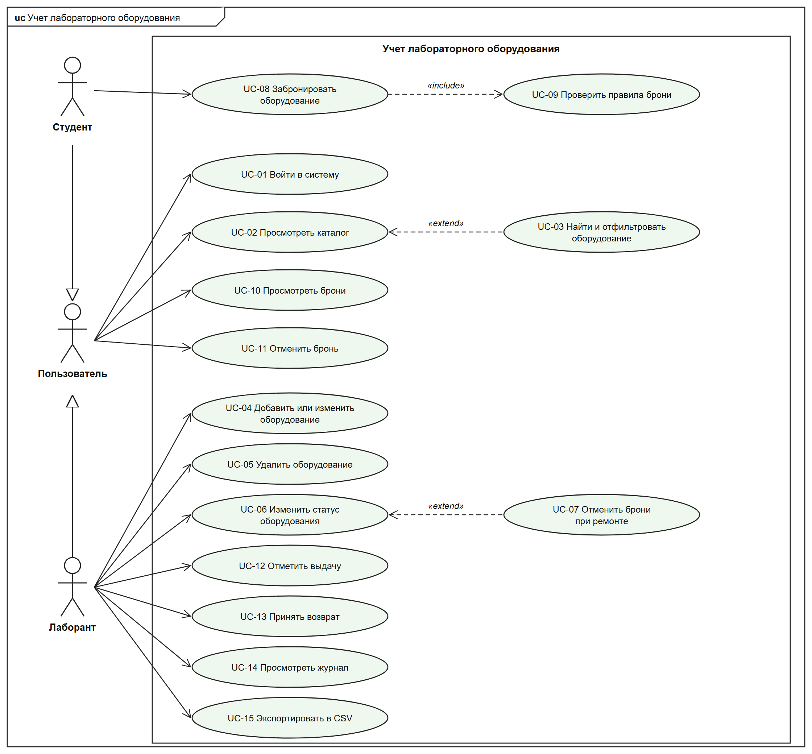

# Модель вариантов использования

Проект **«Учет лабораторного оборудования»**. Версия 1.0, 04.11.2026.

Исходный текст диаграммы: [01_use_cases.uml](01_use_cases.uml).

## Актёры

| Актёр | Описание |
| --- | --- |
| Пользователь | Обобщённая роль любого вошедшего в систему человека. Входит, просматривает каталог и свои брони. |
| Студент | Ищет свободное оборудование, бронирует его на период и отменяет свои брони до выдачи. |
| Лаборант | Ведёт каталог и статусы, отмечает выдачу и возврат, видит все брони и выгружает данные для инвентаризации. |

## Прецеденты

### UC-01. Войти в систему

- **Актёр:** Пользователь
- **Требования:** REQ-FUNC-001, REQ-SEC-001
- **Пояснение:** Открывает главное окно с действиями, доступными роли пользователя.
- **Предусловия:** Приложение запущено, учётная запись создана при установке.

**Основной поток:**

1. Система показывает окно входа.
2. Пользователь вводит логин и пароль и нажимает «Войти».
3. Система проверяет логин и хеш пароля.
4. Система открывает главное окно с именем и ролью пользователя.

**Альтернативные потоки:**

- А1. Поля пустые: на шаге 3 система показывает «Введите логин и пароль» и возвращается к шагу 2.
- А2. Данные неверны: на шаге 3 система показывает «Неверный логин или пароль», очищает пароль и возвращается к шагу 2.

**Постусловия:** Открыто главное окно, набор действий соответствует роли.

### UC-02. Просмотреть каталог

- **Актёр:** Пользователь
- **Требования:** REQ-FUNC-002
- **Пояснение:** Показывает таблицу оборудования с инвентарным номером, наименованием, категорией, помещением и статусом.
- **Предусловия:** Пользователь вошёл в систему (UC-01).

**Основной поток:**

1. Пользователь открывает вкладку «Оборудование».
2. Система загружает список оборудования.
3. Система показывает таблицу, статус выделен цветом.

**Альтернативные потоки:**

- А1. Пользователь задаёт условия поиска: выполняется расширение UC-03.

**Постусловия:** Данные не изменены.

### UC-03. Найти и отфильтровать оборудование

- **Актёр:** Пользователь
- **Требования:** REQ-FUNC-002
- **Пояснение:** Расширяет UC-02: сужает таблицу по тексту и статусу.
- **Предусловия:** Открыт каталог (UC-02).

**Основной поток:**

1. Пользователь вводит текст или выбирает статус.
2. Система ищет без учёта регистра по номеру, наименованию, категории и помещению.
3. Система показывает подходящие записи.

**Альтернативные потоки:**

- А1. Ничего не найдено: система показывает пустую таблицу.

**Постусловия:** Таблица показывает отобранные записи, данные не изменены.

### UC-04. Добавить или изменить оборудование

- **Актёр:** Лаборант
- **Требования:** REQ-FUNC-003
- **Пояснение:** Создаёт новую запись каталога или редактирует существующую.
- **Предусловия:** Лаборант вошёл в систему (UC-01).

**Основной поток:**

1. Лаборант нажимает «Добавить» или выбирает запись и нажимает «Изменить».
2. Система показывает форму.
3. Лаборант заполняет поля и нажимает «Сохранить».
4. Система удаляет пробелы по краям и проверяет длину полей и уникальность номера.
5. Система сохраняет запись; новое оборудование получает статус «Свободно».

**Альтернативные потоки:**

- А1. Нарушено правило: на шаге 4 форма показывает причину и остаётся открытой.
- А2. Лаборант нажимает «Отмена»: форма закрывается без изменений.

**Постусловия:** Каталог содержит новую или изменённую запись.

### UC-05. Удалить оборудование

- **Актёр:** Лаборант
- **Требования:** REQ-FUNC-004
- **Пояснение:** Удаляет списанное оборудование вместе с историей броней.
- **Предусловия:** Лаборант вошёл в систему (UC-01). Запись выбрана в каталоге.

**Основной поток:**

1. Лаборант нажимает «Удалить».
2. Система запрашивает подтверждение.
3. Лаборант подтверждает удаление.
4. Система проверяет, что действующих броней нет.
5. Система удаляет запись и историю её броней.

**Альтернативные потоки:**

- А1. Лаборант отказывается: данные сохраняются без изменений.
- А2. Есть действующие брони: на шаге 4 система показывает причину отказа, запись остаётся.

**Постусловия:** Запись и её брони удалены.

### UC-06. Изменить статус оборудования

- **Актёр:** Лаборант
- **Требования:** REQ-FUNC-005
- **Пояснение:** Переводит оборудование в ремонт или возвращает в строй.
- **Предусловия:** Лаборант вошёл в систему (UC-01). Запись выбрана в каталоге.

**Основной поток:**

1. Лаборант нажимает «Перевести в ремонт» или «Вернуть в строй».
2. Система проверяет, что оборудование не выдано.
3. Система меняет статус.
4. Если оборудование уходит в ремонт, выполняется расширение UC-07.
5. Система показывает результат в строке состояния.

**Альтернативные потоки:**

- А1. Оборудование выдано студенту: на шаге 2 система отказывает с текстом «Сначала примите оборудование».

**Постусловия:** Статус изменён.

### UC-07. Отменить брони при ремонте

- **Актёр:** Лаборант
- **Требования:** REQ-FUNC-005
- **Пояснение:** Расширяет UC-06: автоматически отменяет активные брони оборудования, уходящего в ремонт.
- **Предусловия:** Выполняется UC-06, новый статус – «В ремонте».

**Основной поток:**

1. Система находит брони оборудования в состоянии «Активна».
2. Система отменяет их с пометкой «Оборудование переведено в ремонт».
3. Система сообщает число отмен.

**Альтернативные потоки:**

- А1. Активных броней нет: число отмен равно нулю.

**Постусловия:** На оборудование в ремонте нет активных броней.

### UC-08. Забронировать оборудование

- **Актёр:** Студент
- **Требования:** REQ-FUNC-006
- **Пояснение:** Закрепляет свободное оборудование за студентом на период.
- **Предусловия:** Студент вошёл в систему (UC-01). Оборудование выбрано в каталоге.

**Основной поток:**

1. Студент нажимает «Забронировать».
2. Система показывает форму с датами.
3. Студент вводит даты и подтверждает.
4. Система проверяет правила (включение UC-09).
5. Система создаёт бронь в состоянии «Активна» и сохраняет её.
6. Форма закрывается, система показывает сообщение об успехе.

**Альтернативные потоки:**

- А1. Нарушено правило: на шаге 4 форма показывает причину и остаётся открытой, бронь не создаётся.
- А2. Студент нажимает «Отмена»: форма закрывается без изменений.

**Постусловия:** Создана бронь, студент видит её в «Моих бронированиях».

### UC-09. Проверить правила брони

- **Актёр:** Студент
- **Требования:** REQ-FUNC-006
- **Пояснение:** Включается в UC-08: последовательно проверяет правила и останавливается на первом нарушении.
- **Предусловия:** Выполняется UC-08.

**Основной поток:**

1. Система проверяет роль и наличие оборудования.
2. Система проверяет, что оборудование не в ремонте.
3. Система проверяет даты: заданы, не в прошлом, окончание не раньше начала.
4. Система проверяет срок: не более 7 дней.
5. Система проверяет лимит: менее 3 действующих броней.
6. Система проверяет отсутствие пересечений.

**Альтернативные потоки:**

- Е1. Правило нарушено: проверка завершается с текстом причины, управление возвращается в UC-08.

**Постусловия:** Получен результат проверки, данные не изменены.

### UC-10. Просмотреть брони

- **Актёр:** Пользователь
- **Требования:** REQ-FUNC-007
- **Пояснение:** Показывает брони: студенту только свои, лаборанту все.
- **Предусловия:** Пользователь вошёл в систему (UC-01).

**Основной поток:**

1. Пользователь открывает вкладку бронирований.
2. Система выбирает брони согласно роли.
3. Система показывает период, статус и примечание.

**Альтернативные потоки:**

- А1. Пользователь включает «Только действующие»: система скрывает завершённые и отменённые брони.

**Постусловия:** Данные не изменены.

### UC-11. Отменить бронь

- **Актёр:** Пользователь
- **Требования:** REQ-FUNC-007
- **Пояснение:** Освобождает оборудование, если планы изменились.
- **Предусловия:** Пользователь вошёл в систему (UC-01). Бронь выбрана в таблице.

**Основной поток:**

1. Пользователь нажимает «Отменить бронь».
2. Система проверяет права и состояние брони.
3. Система переводит бронь в состояние «Отменена» с примечанием.
4. Система обновляет таблицу.

**Альтернативные потоки:**

- А1. Студент отменяет чужую бронь: система отказывает.
- А2. Бронь уже отменена или завершена: система отказывает.
- А3. Бронь выдана: система отказывает, нужен возврат.

**Постусловия:** Бронь отменена, период снова свободен.

### UC-12. Отметить выдачу

- **Актёр:** Лаборант
- **Требования:** REQ-FUNC-008
- **Пояснение:** Фиксирует, что студент забрал оборудование по брони.
- **Предусловия:** Лаборант вошёл в систему (UC-01). Бронь выбрана в журнале.

**Основной поток:**

1. Лаборант нажимает «Выдать».
2. Система проверяет, что бронь активна, сегодняшняя дата входит в период, оборудование свободно.
3. Система переводит бронь в состояние «Выдана» и фиксирует дату выдачи.
4. Журнал обновляется.

**Альтернативные потоки:**

- А1. Период ещё не начался или уже закончился: система отказывает.
- А2. Оборудование в ремонте: система отказывает.
- А3. Бронь уже выдана: система отказывает.

**Постусловия:** Бронь выдана, дата выдачи сохранена.

### UC-13. Принять возврат

- **Актёр:** Лаборант
- **Требования:** REQ-FUNC-008
- **Пояснение:** Фиксирует, что студент вернул оборудование.
- **Предусловия:** Лаборант вошёл в систему (UC-01). Выбрана бронь в состоянии «Выдана».

**Основной поток:**

1. Лаборант нажимает «Принять».
2. Система проверяет, что бронь выдана.
3. Система переводит бронь в состояние «Возвращена» и фиксирует дату возврата.
4. Журнал обновляется.

**Альтернативные потоки:**

- А1. Бронь не выдавалась: система отказывает.

**Постусловия:** Бронь завершена, оборудование снова можно бронировать и переводить в ремонт.

### UC-14. Просмотреть журнал

- **Актёр:** Лаборант
- **Требования:** REQ-FUNC-008
- **Пояснение:** Показывает выданное оборудование и просроченные возвраты.
- **Предусловия:** Лаборант вошёл в систему (UC-01).

**Основной поток:**

1. Лаборант открывает вкладку «Журнал».
2. Лаборант выбирает фильтр «Выдано сейчас», «Просрочено» или «Все».
3. Система показывает записи, просроченные выделены красным.

**Альтернативные потоки:**

- А1. Подходящих записей нет: система показывает пустую таблицу.

**Постусловия:** Данные не изменены.

### UC-15. Экспортировать в CSV

- **Актёр:** Лаборант
- **Требования:** REQ-FUNC-009
- **Пояснение:** Выгружает каталог или журнал в файл для инвентаризации в Excel.
- **Предусловия:** Лаборант вошёл в систему (UC-01).

**Основной поток:**

1. Лаборант нажимает «Экспорт» и выбирает каталог или журнал.
2. Система показывает диалог сохранения файла.
3. Лаборант выбирает файл.
4. Система записывает UTF-8 с BOM, разделитель «;», заголовки столбцов и экранирование.
5. Система показывает результат.

**Альтернативные потоки:**

- А1. Лаборант отменяет диалог: файл не создаётся.
- Е1. Ошибка записи: система показывает причину.

**Постусловия:** Файл CSV сохранён, данные приложения не изменены.

